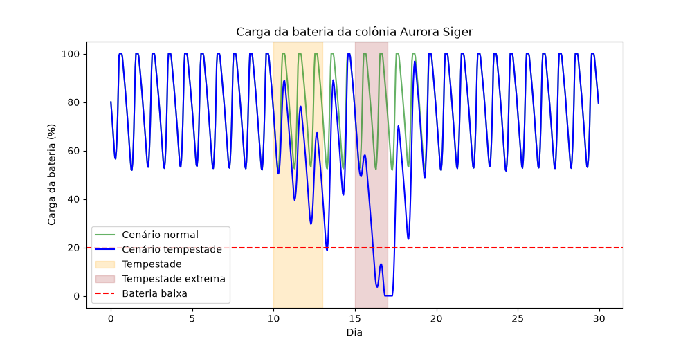
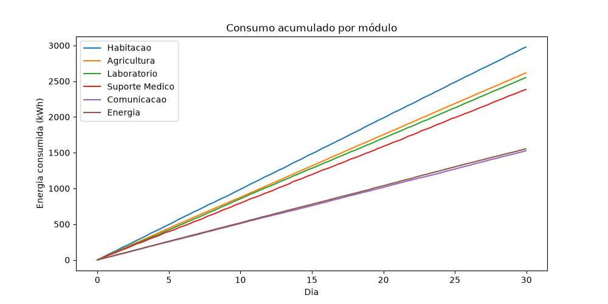
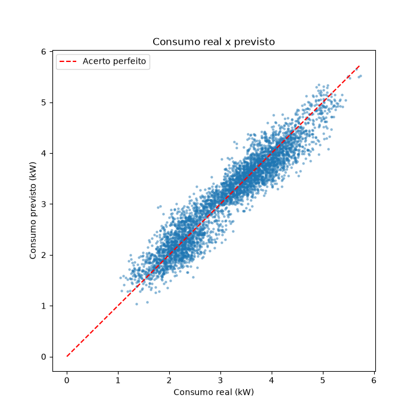
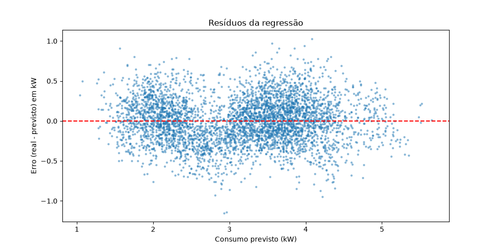
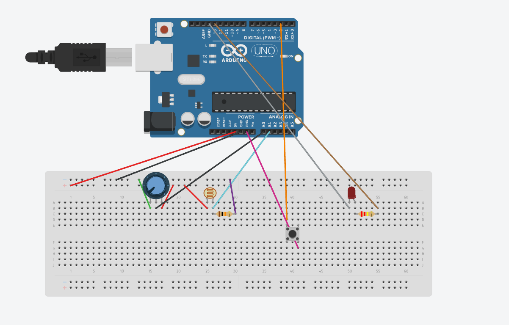
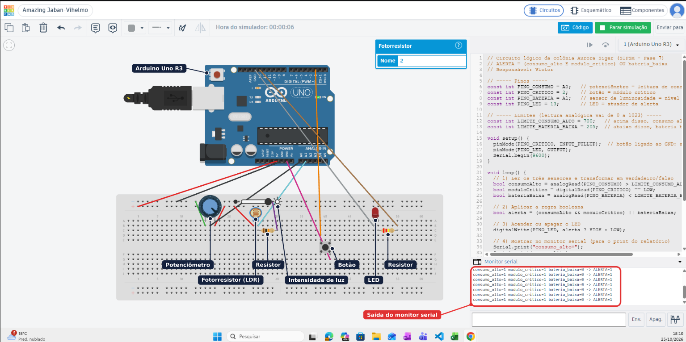
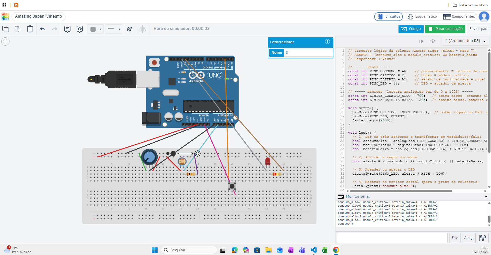

# Relatório Técnico - SIFSM

Sistema Integrado de Futuro Sustentável em Marte (SIFSM) - Missão Aurora Siger, Fase 7.

| Integrante | RM | Responsabilidade principal |
| --- | --- | --- |
| Aelton Soares de Menezes | 573694 | IA e sistemas multiagentes, sustentabilidade, documentação e entrega |
| Bruno Santos Martins | 572073 | Banco de dados, CRUD, estruturas de dados e integração do menu |
| Michelly Nunes dos Santos | 573625 | Base de dados simulada, simulação computacional e modelagem linear |
| Victor Gonçalves Mantovani | 570608 | Lógica booleana, circuito no Tinkercad e arquitetura computacional |

## 1. Contexto da solução

A colônia Aurora Siger depende de um único sistema de energia, formado por painéis solares e por uma bateria, para manter seis módulos funcionando: Habitação, Agricultura, Laboratório, Suporte Médico, Comunicação e Energia. Três deles (Habitação, Suporte Médico e Energia) são críticos, porque sustentam diretamente a vida da tripulação. Em Marte, a geração solar varia ao longo do sol (o dia marciano) e cai durante tempestades de poeira, então qualquer desperdício de energia ou atraso em um alerta pode comprometer a missão.

O SIFSM é um protótipo de linha de comando que reúne, em um único menu, as ferramentas para a equipe de solo e a tripulação acompanharem essa operação:

- registrar e consultar as leituras dos sensores (banco de dados com CRUD);
- decidir quando uma leitura gera alerta (regra booleana, também montada como circuito no Tinkercad);
- organizar os chamados e calcular o efeito em cascata de uma falha (estruturas de dados);
- prever o estado de carga da bateria em diferentes cenários (simulação por integração numérica);
- estimar o consumo esperado de cada módulo (regressão linear);
- responder às solicitações da tripulação com agentes especializados, sob supervisão humana (sistema multiagente);
- avaliar o impacto sustentável e social das decisões tomadas pelo sistema.

## 2. Objetivos

1. Integrar em um protótipo funcional os conteúdos da Fase 7: banco de dados, lógica, estruturas de dados, simulação, modelagem linear, IA, arquitetura computacional e sustentabilidade.
2. Usar uma única base de dados da missão como contrato entre os módulos, para que cada parte possa ser desenvolvida de forma independente e integrada no final.
3. Apoiar a decisão humana, sem substituí-la: o sistema recomenda, e as ações críticas dependem de aprovação de uma pessoa responsável.

## 3. Arquitetura da solução

```text
dados_aurora_siger.csv ──► database.py (SQLite + CRUD) ──► codigo_fonte.py (menu CLI)
                                   │                              │
                 ┌─────────────────┼──────────────┬───────────────┼──────────────┐
                 ▼                 ▼              ▼               ▼              ▼
          structures.py     logic_rules.py  simulacao_       ml_model.py     agents.py
          hash, fila,       regra booleana  computacional.py regressão       triador +
          grafo + BFS       e prioridade    SoC (trapézio)   linear          especialistas
```

O CSV é o contrato de dados: suas colunas foram congeladas no início do projeto, e cada etapa preenche as colunas sob sua responsabilidade (`soc_bateria_pct` e `consumo_previsto_kw` pela simulação e pela regressão, `alerta` e `prioridade` pela regra lógica). O banco espelha o CSV, e o menu `codigo_fonte.py` chama as funções públicas de cada módulo, cujas assinaturas também foram congeladas no início (ver `docs/divisao_fase7.md`).

## 4. Dados da missão

A base `dados_aurora_siger.csv` é gerada pelo script `gerar_dados.py` com semente fixa (`random_seed=42`), o que torna os resultados reproduzíveis. Ela contém leituras horárias dos 6 módulos durante 30 dias (720 horas), totalizando 4.320 registros, a partir de 14/10/2026. A amostra `dados_amostra.csv` (48 linhas) serviu de base para o desenvolvimento paralelo.

| Grupo de colunas | Colunas |
| --- | --- |
| Identificação | `timestamp`, `modulo_id`, `modulo_nome`, `modulo_tipo`, `modulo_critico`, `sensor_id` |
| Leituras | `temperatura_c`, `ocupacao`, `geracao_solar_kw`, `consumo_kw`, `consumo_alto`, `status` |
| Simulação e regressão | `soc_bateria_pct`, `consumo_previsto_kw` |
| Regra lógica | `alerta`, `prioridade` |

A geração solar segue uma curva diária (0 kW à noite e até 90 kW ao meio-dia), reduzida em até 10% pela poeira. O consumo de cada módulo combina uma carga base, a ocupação, o turno de trabalho e o aquecimento necessário quando a temperatura fica abaixo da temperatura de conforto. Nenhuma coluna identifica pessoas: a ocupação é apenas a contagem de tripulantes no módulo.

## 5. Desenvolvimento

### 5.1 Banco de dados e CRUD (Bruno)

**Modelo das tabelas.** O `script_banco.sql` cria quatro tabelas normalizadas, ligadas por chaves estrangeiras (com `PRAGMA foreign_keys = ON`):

| Tabela | Chave | Conteúdo |
| --- | --- | --- |
| `modulos` | `modulo_id` | Nome, tipo e se o módulo é crítico |
| `sensores` | `sensor_id` | Código do sensor e o módulo em que está instalado |
| `leituras` | `leitura_id` (autoincremento) | Leitura horária: temperatura, ocupação, geração solar, consumo, SoC e consumo previsto |
| `alertas` | `alerta_id` | Leituras em alerta e a prioridade (1 a 5) |

Separar módulos e sensores das leituras evita repetir o nome e o tipo do módulo em cada uma das 4.320 linhas, e a tabela `alertas` guarda só as 553 leituras que dispararam a regra. A consulta de listagem junta as quatro tabelas e devolve cada leitura com as mesmas colunas do CSV, o que mantém o contrato de dados entre os módulos.

**Carga do CSV.** A opção 1 do menu lê o `dados_aurora_siger.csv` com `csv.DictReader`, converte cada campo para o tipo da coluna e grava módulo, sensor, leitura e alerta. O `commit` só acontece depois da última linha: se qualquer linha tiver erro, nada é gravado. O menu também impede uma segunda carga sobre o banco já preenchido, que duplicaria as leituras e dobraria o consumo de cada hora.

**CRUD.** As funções do contrato são `cadastrar_registro()`, `listar_registros(filtro)` (filtros por leitura, módulo, sensor ou alerta), `alterar_registro()` (só nas colunas editáveis) e `excluir_registro()` (apaga o alerta antes da leitura, respeitando a chave estrangeira). As consultas usam parâmetros (`?`), nunca texto concatenado com a entrada do usuário, o que evita injeção de SQL.

**Tratamento de erros.** Todas as operações seguem o padrão `try`, `except`, `else` e `finally`: `ValueError` para números inválidos ou campos obrigatórios em branco, `LookupError` para registros inexistentes, `FileNotFoundError` para o CSV ausente e `sqlite3.Error` para falhas do banco. O `else` mostra a confirmação e o `finally` sempre fecha a conexão. O teste do módulo (`python database.py`) roda em um banco temporário e provoca cada um desses erros.

**Por que SQLite.** O enunciado aceita Oracle ou outro banco. O SQLite já vem com o Python e dispensa servidor, credenciais e VPN, então qualquer pessoa executa o projeto sem configuração. O schema usa SQL padrão e pode ser migrado para Oracle com poucos ajustes de tipos.

### 5.2 Regra lógica e circuito (Victor)

**Expressão lógica.** Uma leitura gera alerta quando um módulo crítico está com consumo alto ou quando a bateria da colônia está baixa:

$$ALERTA = (consumo\_alto \land modulo\_critico) \lor bateria\_baixa$$

A bateria é considerada baixa abaixo de 20% de SoC (`LIMITE_BATERIA_BAIXA_PCT`), o mesmo limite usado na simulação e pelos agentes. A função `avaliar_alerta()` implementa a expressão, e `bateria_esta_baixa()` converte o SoC em verdadeiro ou falso.

**Tabela verdade.** `tabela_verdade()` gera as 8 combinações com `itertools.product`; 5 delas disparam o alerta:

| consumo_alto | modulo_critico | bateria_baixa | ALERTA |
| :---: | :---: | :---: | :---: |
| 0 | 0 | 0 | 0 |
| 0 | 0 | 1 | 1 |
| 0 | 1 | 0 | 0 |
| 0 | 1 | 1 | 1 |
| 1 | 0 | 0 | 0 |
| 1 | 0 | 1 | 1 |
| 1 | 1 | 0 | 1 |
| 1 | 1 | 1 | 1 |

**Prioridade.** `classificar_prioridade()` dá prioridade 1 às leituras sem alerta. Com alerta, parte de 2 e soma 1 ponto se o módulo é crítico, 1 se a bateria está abaixo de 20% e 1 se o consumo real está pelo menos 20% acima do previsto pela regressão (seção 5.5), com teto 5. Assim, a prioridade combina a regra lógica com a previsão do modelo linear.

**Aplicação à base.** `python logic_rules.py aplicar` percorre o CSV linha a linha e preenche `alerta` e `prioridade`. Resultado: 553 das 4.320 leituras (12,8%) estão em alerta, 204 por bateria baixa e 349 por consumo alto em módulo crítico. As prioridades ficaram em 3 (392 leituras), 4 (157) e 5 (4). O módulo de Energia concentra 278 alertas, porque é crítico e tem muitas leituras de consumo alto.

**Circuito no Tinkercad.** O `circuito_logico.ino` reproduz a mesma regra em um Arduino Uno: o potenciômetro (A0) faz o papel do consumo, alto acima de 700 na escala de 0 a 1023; o botão (pino 2, com `INPUT_PULLUP`) indica módulo crítico; o fotorresistor (A1) representa a carga da bateria, baixa abaixo de 205 (cerca de 20% da escala); e o LED no pino 13 é o atuador de alerta. A cada 200 ms o programa lê os sensores, aplica `(consumoAlto && moduloCritico) || bateriaBaixa`, acende ou apaga o LED e escreve as entradas e a saída no monitor serial. O circuito está em `circuito_logico.png` e o link em `link_tinkercad.txt`. Os cinco testes da seção 6 cobrem os casos principais da tabela verdade.

### 5.3 Estruturas de dados (Bruno)

O módulo `structures.py` usa três estruturas, cada uma escolhida pelo tipo de pergunta que a operação da colônia precisa responder:

**Tabela hash (`dict`).** `indice_sensores` e `indice_modulos` são preenchidos a partir do banco e permitem localizar um sensor ou módulo pelo código em tempo médio $O(1)$, sem percorrer as 4.320 leituras. `buscar_sensor("S-HAB-01")` devolve o sensor com os dados do módulo. Se o código não estiver no índice, o índice é recarregado uma vez, o que cobre sensores cadastrados depois do início do programa.

**Fila de chamados (`collections.deque`).** Cada leitura em alerta vira um chamado de manutenção. `enfileirar_chamado()` insere o chamado antes do primeiro de prioridade menor, então a fila fica ordenada por prioridade na entrada e, dentro da mesma prioridade, quem chegou primeiro sai primeiro (FIFO). `proximo_chamado()` retira o primeiro com `popleft()` em $O(1)$. Com a base completa, a fila recebe 553 chamados e começa pelos 4 de prioridade 5, todos no módulo de Energia durante a tempestade.

**Grafo de dependência com BFS.** A lista de adjacência `DEPENDENCIAS` registra quem depende de quem: a Energia alimenta Suporte Médico, Agricultura, Laboratório e Comunicação, e a Habitação depende do Suporte Médico e da Agricultura. `impacto_falha()` faz uma busca em largura a partir do módulo que falhou e devolve os afetados com o nível de distância. Uma falha na Energia atinge quatro módulos no nível 1 e a Habitação no nível 2. A busca em largura foi escolhida porque visita primeiro os efeitos diretos, que são os mais urgentes, e a lista de visitados impede repetir um módulo.

Essas estruturas são reutilizadas pelos agentes (seção 5.6): o Agente de Manutenção lê a fila para listar os alertas e usa o grafo para explicar o efeito em cascata de uma falha.

### 5.4 Simulação computacional e integração matemática (Michelly)

**Modelo.** O estado de carga (SoC) da bateria da colônia é a integral do balanço de potência ao longo do tempo:

$$SoC(t) = SoC_0 + \frac{1}{C}\int_0^t \left(P_{solar}(\tau) - P_{consumo}(\tau)\right)d\tau$$

com capacidade $C = 500$ kWh e $SoC_0 = 80\%$. A cada hora, $P_{solar}$ é a geração solar da leitura e $P_{consumo}$ é a soma do consumo dos seis módulos.

**Método numérico.** Como as leituras são horárias, a integral é calculada pela regra do trapézio, com $\Delta t = 1$ h:

$$E_i = \frac{(P_{solar} - P_{consumo})_{i-1} + (P_{solar} - P_{consumo})_i}{2} \cdot \Delta t \qquad SoC_i = SoC_{i-1} + \frac{E_i}{C} \cdot 100$$

O SoC é limitado entre 0% e 100%, porque a bateria não carrega acima da capacidade nem descarrega abaixo de vazia. A mesma regra do trapézio calcula a energia acumulada de cada módulo (`energia_acumulada()`), que é a área sob a curva de consumo.

**Cenários.** `simular_soc(df, cenario)` compara dois cenários sobre os mesmos 30 dias de leituras:

- **normal:** geração solar das leituras;
- **tempestade:** tempestade de poeira com o sol a 70% nos dias 10 a 12 e tempestade extrema com o sol a 40% nos dias 15 e 16.

| Cenário | SoC mínimo | Horas abaixo de 20% | Horas com a bateria zerada | SoC final |
| --- | ---: | ---: | ---: | ---: |
| Normal | 51,4% | 0 | 0 | 79,6% |
| Tempestade | 0,0% | 34 | 12 | 79,6% |

No cenário normal, a bateria oscila entre cerca de 52% à noite e 100% ao meio-dia e nunca chega ao limite de alerta. Na tempestade, a carga já cai abaixo de 20% no fim do primeiro episódio e zera por 12 horas na tempestade extrema, ou seja, a colônia ficaria sem reserva para os módulos críticos. A bateria se recupera em cerca de dois dias de sol normal. O CSV usa o cenário de tempestade em `soc_bateria_pct`, com o mesmo valor nas 6 linhas de cada horário, para que a regra lógica tenha casos de bateria baixa.

**Energia por módulo.** Nos 30 dias, a Habitação é o maior consumidor (2.976,6 kWh, média de 4,14 kW), seguida por Agricultura (2.615,4 kWh), Laboratório (2.549,9 kWh) e Suporte Médico (2.382,5 kWh). Energia (1.552,2 kWh) e Comunicação (1.525,3 kWh) consomem cerca da metade da Habitação.





**Conclusão para a decisão.** A simulação mostra que a margem da bateria basta para a operação normal, mas não para uma tempestade de vários dias. Antes de uma tempestade prevista, a equipe deveria reduzir as cargas não críticas (Agricultura, Laboratório e Comunicação), que somam mais de 6.600 kWh no período.

### 5.5 Modelagem linear e tomada de decisão (Michelly)

**Análise exploratória.** A correlação com o consumo foi de 0,57 para a ocupação, 0,26 para o turno de trabalho (8h às 18h) e praticamente zero (0,00) para a temperatura. A temperatura sozinha não explica o consumo porque o efeito do aquecimento fica escondido pelas diferenças entre os módulos e pela ocupação. Dentro do modelo múltiplo, porém, ela aparece com efeito claro.

**Modelo.** `treinar_modelo()` ajusta uma regressão linear múltipla com Scikit-Learn (`LinearRegression`):

$$consumo\_previsto = a + b_1 \cdot temperatura + b_2 \cdot ocupacao + b_3 \cdot turno + \sum_{m=1}^{6} c_m \cdot modulo_m$$

em que `turno` vale 1 no horário de trabalho e cada $modulo_m$ é uma variável de sim ou não que identifica o módulo da leitura. Os dados foram divididos em 80% para treino e 20% para teste (`train_test_split` com semente fixa), e as métricas são calculadas apenas no conjunto de teste.

**Coeficientes.**

| Variável | Coeficiente (kW) | Interpretação |
| --- | ---: | --- |
| Intercepto ($a$) | 6,22 | Ponto de partida da equação, que só faz sentido junto com as demais variáveis |
| Temperatura | -0,19 | Cada 1 °C a menos aumenta o consumo em 0,19 kW (aquecimento) |
| Ocupação | +0,31 | Cada tripulante a mais no módulo soma 0,31 kW |
| Turno | +0,45 | No horário de trabalho o módulo consome 0,45 kW a mais |
| Habitação | +0,82 | Módulo de maior carga base |
| Agricultura | +0,59 | |
| Laboratório | +0,31 | |
| Suporte Médico | 0,00 | |
| Comunicação | -0,86 | |
| Energia | -0,87 | Módulo de menor carga base |

Os coeficientes dos módulos só devem ser lidos uns em relação aos outros: nas mesmas condições de temperatura, ocupação e turno, a Habitação consome cerca de 1,7 kW a mais que o módulo de Energia ($0{,}82 - (-0{,}87)$).

**Avaliação.** No conjunto de teste, o modelo obteve **MAE = 0,22 kW**, **RMSE = 0,28 kW** e **$R^2$ = 0,91**. Ou seja, o modelo explica 91% da variação do consumo, e o erro típico é de cerca de 0,2 kW para um consumo médio de 3,15 kW (7%). O RMSE próximo do MAE indica que não há erros muito grandes isolados. No gráfico de valores reais e previstos, os pontos ficam próximos da diagonal. Nos resíduos, os erros se espalham em torno de zero sem um padrão forte, o que é compatível com um modelo linear adequado.





**Uso na tomada de decisão.** A previsão vai para a coluna `consumo_previsto_kw` e é usada pela regra de prioridade (seção 5.2): uma leitura em alerta com consumo pelo menos 20% acima do previsto ganha 1 ponto de prioridade, porque indica um comportamento anormal do módulo, como um equipamento com defeito. Os coeficientes também orientam ações: como a ocupação pesa 0,31 kW por pessoa, concentrar a tripulação em menos módulos durante uma tempestade reduz o consumo.

### 5.6 Integração de IA e sistemas multiagentes (Aelton)

O módulo `agents.py` simula um sistema multiagente que atende às solicitações da tripulação em linguagem natural (por exemplo, "qual o nível da bateria?" ou "o que acontece se a energia falhar?"). Ele segue os conceitos dos frameworks de agentes: **agentes** com papéis definidos, **ferramentas**, **handoffs**, **guardrails** e **sessões**. Os agentes são implementados por regras, sem modelo de linguagem, como se discute ao final desta seção.

**Agentes e handoff.** A função pública do contrato, `agente_triador(solicitacao, sessao)`, recebe o texto da tripulação, normaliza-o (minúsculas e sem acentos, para aceitar "Habitação" e "habitacao") e identifica a intenção por raízes de palavras. Em seguida, faz o *handoff* para um dos dois especialistas:

| Agente | Responde a | Exemplo de solicitação |
| --- | --- | --- |
| Triador | Comandos da sessão (`ajuda`, `histórico`, `aprovar`, `cancelar`) e encaminhamento | "histórico" |
| Agente de Energia | Estado de carga da bateria e pedidos de desligamento de módulos | "desligar o laboratório" |
| Agente de Manutenção | Alertas pendentes e impacto da falha de um módulo | "o que acontece se a energia falhar?" |

Toda resposta indica o caminho percorrido (por exemplo, `[Triador -> Agente de Manutenção]`), o que torna o *handoff* visível para quem usa o sistema.

**Ferramentas.** Os especialistas só agem por meio de ferramentas determinísticas e **somente de leitura**, que reutilizam os outros módulos do projeto:

- `consultar_soc()`: lê no banco o SoC da leitura mais recente e usa `bateria_esta_baixa()` do `logic_rules.py`, com o mesmo limite de 20% da regra booleana e da simulação;
- `listar_alertas()`: busca os chamados na fila de prioridade do `structures.py` ou, se ela estiver vazia, os alertas do banco, ordenados por prioridade;
- `impacto_falha()`: usa o grafo de dependência e a busca em largura do `structures.py` para listar os módulos afetados por uma falha, com o nível de distância (por exemplo, uma falha em Energia atinge Suporte Médico, Agricultura, Laboratório e Comunicação no nível 1 e Habitação no nível 2).

Quando a bateria está abaixo do limite, o Agente de Energia sugere reduzir as cargas **não críticas** (Agricultura, Laboratório e Comunicação), em vez de qualquer módulo que sustente a vida.

**Guardrails.** Antes de qualquer *handoff*, o triador aplica guardrails de entrada, e o Agente de Energia aplica um guardrail de ação:

| Guardrail | O que bloqueia | Resposta |
| --- | --- | --- |
| Entrada vazia ou longa demais | Textos vazios ou com mais de 300 caracteres | Pede uma solicitação válida |
| Dados sensíveis | Senhas, credenciais, CPF, prontuário, dados médicos ou pessoais | Encaminha ao responsável humano |
| Alteração de dados | Pedidos para apagar, excluir ou remover registros | Lembra que alterações são feitas por uma pessoa no menu CRUD |
| Fora do escopo | Qualquer pedido sem relação com energia ou manutenção | Lista o que os agentes sabem fazer |
| Módulo crítico | Desligar Habitação, Suporte Médico ou Energia | Mostra o impacto da falha e deixa a ação pendente até alguém digitar `aprovar` ou `cancelar` |

Mesmo uma ação aprovada é apenas registrada: o protótipo não aciona atuadores, o que deixa claro que a execução física fica a cargo da equipe.

**Sessão.** O histórico da conversa é uma lista de turnos (solicitação, agente que respondeu, resposta e ação pendente). Ele permite consultar o `histórico` e liga a aprovação humana ao pedido que a originou: `aprovar` só vale para a última ação pendente e não pode ser usada duas vezes. O menu cria uma sessão nova a cada conversa.

**Evidências.** O bloco de testes do módulo (`python agents.py`) monta um banco temporário e verifica 15 turnos de conversa: as duas ferramentas, os quatro tipos de *handoff*, os seis guardrails, a aprovação, o cancelamento e o histórico. Todos os testes passam, e os agentes podem ser usados pela opção 10 do menu.

**Por que agentes por regras.** Um modelo de linguagem entenderia frases mais livres, mas exigiria inferência em GPU ou conexão com a Terra, que pode ter de 4 a 24 minutos de atraso de comunicação. As regras dão respostas previsíveis e auditáveis, rodam em CPU e sem conexão e não gastam energia com inferência, o que é coerente com a escassez de energia da colônia (ver seção 5.8). A arquitetura permite evoluir sem mudar o contrato: um modelo de linguagem poderia substituir apenas a etapa de classificação de intenção do triador, mantendo as mesmas ferramentas e os mesmos guardrails. Outra melhoria seria um fluxo de RAG sobre os manuais de manutenção dos módulos, para que o Agente de Manutenção explique como resolver cada alerta.

### 5.7 Arquitetura computacional e desempenho (Victor)

Em uma colônia marciana, cada watt gasto em computação deixa de ir para o suporte à vida. Por isso, a escolha do hardware para cada parte do SIFSM segue o tipo de cálculo e o custo energético.

**CPU para o CRUD, as regras e os agentes.** O banco, a regra booleana, as estruturas de dados e os agentes por regras fazem operações sequenciais, com muitos desvios condicionais e pouco cálculo numérico. Esse é o perfil em que a CPU é mais eficiente: poucos núcleos rápidos, com previsão de desvios e cache. Todo o protótipo roda em CPU comum, e a carga dos 4.320 registros leva poucos segundos.

**Microcontrolador na borda.** A regra de alerta é simples a ponto de rodar em um Arduino (seção 5.2), que consome menos de 1 W. Em uma instalação real, cada módulo teria um microcontrolador que avalia o alerta localmente e acende o atuador mesmo se a rede ou o computador central falhar. Só os resultados sobem para o servidor, e não cada leitura bruta.

**GPU, NPU e TPU para modelos maiores.** A regressão linear treina em milissegundos em CPU e não justifica um acelerador. Uma GPU, com milhares de núcleos simples executando a mesma operação sobre muitos dados (SIMD), faria diferença no treino de modelos maiores, como redes neurais para prever a geração solar a partir de imagens de poeira. NPUs e TPUs são especializadas em multiplicação de matrizes com baixa precisão e oferecem mais inferências por watt. Elas seriam a escolha para rodar localmente um modelo de linguagem pequeno nos agentes (seção 5.6), evitando depender da Terra, que está de 4 a 24 minutos de distância.

**Paralelismo nas simulações.** Cada cenário de SoC é independente dos outros, então vários cenários (diferentes durações de tempestade, capacidades de bateria ou cortes de carga) poderiam ser simulados em paralelo, um por núcleo. Dentro de um mesmo cenário, porém, cada hora depende da anterior, e o laço é sequencial por natureza. Já o cálculo da energia acumulada dos seis módulos e as previsões da regressão sobre as 4.320 linhas são operações vetoriais, que o NumPy executa com instruções SIMD da própria CPU.

**Memória e movimentação de dados.** A base inteira ocupa menos de 0,5 MB e cabe na memória RAM e até no cache dos processadores atuais. Por isso, o gargalo não é o cálculo, e sim a movimentação: ler o disco e trocar dados entre CPU e GPU custa mais tempo e energia do que as operações em si. O protótipo reduz essa movimentação carregando os índices hash uma vez e consultando o banco com filtros, em vez de ler as 4.320 leituras a cada pergunta.

**Custo energético.** Na hierarquia de memória, buscar um dado na RAM gasta muito mais energia do que fazer uma operação aritmética, e transmitir pela rede gasta ainda mais. Para a colônia, isso leva a três escolhas: processar perto do sensor, usar o acelerador só quando o ganho compensa o consumo e preferir modelos pequenos e explicáveis, como a regressão e os agentes por regras. A seção 5.8 trata do mesmo tema do ponto de vista da sustentabilidade.

### 5.8 Sustentabilidade, cidadania digital e impacto socioambiental (Aelton)

Em uma colônia marciana, sustentabilidade não é um tema à parte: a energia disponível é limitada, não há como repor peças rapidamente e cada decisão automatizada afeta diretamente a vida da tripulação. Esta seção analisa como o SIFSM trata essas questões e o que cada escolha do protótipo ensina para sistemas semelhantes na Terra.

#### 5.8.1 Simulação para evitar desperdício

A simulação do estado de carga (seção 5.4) permite testar decisões antes de executá-las. Nos 30 dias simulados, os painéis geram cerca de 17.105 kWh, e os módulos consomem cerca de 13.602 kWh. No cenário normal, a bateria nunca fica abaixo de 51%. No cenário com tempestades de poeira, ela passa 34 horas abaixo do limite de 20% e 12 horas descarregada. Sem a simulação, a equipe só perceberia o problema quando ele já estivesse acontecendo. Com ela, pode planejar com antecedência, por exemplo reduzindo as cargas não críticas antes da tempestade ou adiando atividades do laboratório.

A energia acumulada por módulo também mostra onde agir: Habitação (cerca de 2.977 kWh) e Agricultura (cerca de 2.615 kWh) são os maiores consumidores, enquanto Comunicação e Energia consomem cerca de metade disso. A regressão linear (seção 5.5) completa essa análise ao comparar o consumo real com o previsto: um consumo bem acima do previsto indica desperdício ou defeito, e esse desvio entra no cálculo da prioridade do alerta.

O mesmo raciocínio vale para a Terra: simular o balanço entre geração renovável e consumo é o que permite a microrredes solares, hospitais e comunidades isoladas economizar energia e evitar apagões (ODS 7, energia limpa e acessível, e ODS 12, consumo e produção responsáveis).

#### 5.8.2 Privacidade e proteção dos dados da tripulação

A base de dados foi desenhada para não guardar dados pessoais: a ocupação é apenas a contagem de pessoas em cada módulo, sem nomes, horários individuais ou dados de saúde. Esse é o princípio da minimização de dados da LGPD (Lei 13.709/2018): coletar apenas o necessário para a finalidade, que aqui é a gestão de energia.

Os agentes reforçam essa proteção: o guardrail de dados sensíveis recusa pedidos sobre senhas, credenciais, CPF, prontuários e dados médicos ou pessoais e encaminha o pedido ao responsável humano. As ferramentas dos agentes só leem o banco e não podem alterar nem excluir registros. As configurações sensíveis (como credenciais de banco) ficam fora do repositório, porque o `.gitignore` bloqueia arquivos `.env`, chaves e o próprio banco local.

Em uma versão real, a contagem de ocupação vinda de sensores de presença poderia, combinada com horários, revelar a rotina de cada tripulante. Por isso, a recomendação é agregar os dados por módulo e por hora, como faz o protótipo, e definir quem pode consultá-los.

#### 5.8.3 Impacto ambiental de data centers e da IA

Treinar e executar modelos de IA consome energia, água para resfriamento de *data centers* e hardware com minerais escassos. Na colônia, esse custo é ainda mais visível, porque cada kWh gasto com computação deixa de ir para o suporte à vida. O SIFSM foi pensado para ter baixo custo computacional:

- os agentes funcionam por regras, sem inferência de modelo de linguagem;
- a regressão linear treina em segundos em CPU, sem GPU;
- a simulação usa integração numérica simples sobre 720 pontos;
- o banco SQLite é um arquivo local, sem servidor ligado o tempo todo.

A escolha segue o princípio de usar o modelo mais simples que resolve o problema. Uma solução de IA mais pesada só se justificaria se o ganho de qualidade superasse o custo energético, comparação que o capítulo 5.7 detalha do ponto de vista do hardware.

#### 5.8.4 Inovação responsável: benefícios e riscos

| Benefício | Risco | Como o protótipo mitiga |
| --- | --- | --- |
| Alertas automáticos e priorizados | Excesso de confiança no alerta ou falso negativo | Regra simples e auditável (tabela verdade); prioridade explicada por critérios públicos |
| Previsão de consumo e de SoC | Modelo errar fora das condições simuladas | Métricas MAE, RMSE e $R^2$ publicadas; limitações declaradas no relatório |
| Agentes que respondem em linguagem natural | Ação indevida tomada por um agente | Ferramentas só de leitura; desligamento de módulo crítico exige aprovação humana |
| Cálculo do impacto em cascata de uma falha | Grafo de dependência desatualizado | Dependências declaradas em um único lugar (`structures.py`), fáceis de revisar |
| Dados centralizados em banco | Vazamento ou uso indevido dos dados | Minimização de dados; nenhum dado pessoal na base |

A concentração de alertas no módulo de Energia, que é crítico e tem picos de consumo, também é um aprendizado: uma regra única pode gerar alertas demais em um módulo e "cansar" a equipe, e por isso a prioridade de 1 a 5 é necessária para ordenar o atendimento.

#### 5.8.5 Diversidade e inclusão na concepção dos agentes

Uma tripulação de missão longa reúne pessoas de idiomas, formações e capacidades diferentes, e o sistema precisa servir a todas elas:

- o triador aceita texto com ou sem acentos e com variações de palavras ("desligar", "desligue", "corte"), para não exigir uma forma "correta" de escrever;
- as respostas usam linguagem simples, sem jargão técnico, e sempre dizem o que o agente pode fazer quando não entende o pedido;
- a interface de texto no terminal funciona com leitores de tela;
- as decisões dos agentes dependem da situação dos módulos, nunca do perfil de quem pergunta, o que evita tratar tripulantes de forma diferente.

O desenvolvimento em equipe, com quatro integrantes revisando o trabalho uns dos outros (revisão cruzada), também ajuda a reduzir pontos cegos de quem projeta o sistema. Como melhoria, os agentes poderiam ser testados com usuários de perfis diferentes e oferecer respostas em outros idiomas e em áudio.

#### 5.8.6 Supervisão humana sobre as decisões

O princípio central do SIFSM é que **o sistema recomenda e a pessoa decide**:

- os agentes não alteram nem excluem dados; o CRUD é usado por uma pessoa no menu;
- o desligamento de um módulo crítico fica pendente até que o responsável de turno digite `aprovar` ou `cancelar`, depois de ver quais módulos seriam afetados;
- mesmo depois de aprovada, a ação é apenas registrada, e a execução física continua com a equipe;
- a opção "Analisar sustentabilidade da colônia" termina sempre com o lembrete de que a decisão final deve ser validada por uma pessoa responsável;
- o histórico de sessão registra quem pediu o quê e qual agente respondeu, o que permite auditar as decisões depois.

Essa supervisão segue o que diretrizes de IA responsável, como o AI Act europeu e a Recomendação da UNESCO sobre a Ética da IA, exigem para sistemas de alto risco: transparência, rastreabilidade e controle humano efetivo.

#### 5.8.7 Cidadania digital

O protótipo trata a tecnologia como apoio à comunidade da colônia, e não como substituto da responsabilidade humana: os dados servem à segurança coletiva, as regras são públicas e explicáveis, e cada tripulante pode questionar uma recomendação do sistema. Na Terra, os mesmos princípios valem para cidades inteligentes e redes elétricas: transparência sobre o que é coletado, proteção dos dados das pessoas e participação humana nas decisões automatizadas.

## 6. Resultados e evidências

**Circuito lógico.** Os cinco testes no Tinkercad mostram o LED e o monitor serial para os casos principais da tabela verdade:

| Teste | Entradas | LED (ALERTA) | Figura |
| --- | --- | :---: | --- |
| 1. Operação normal | consumo normal, módulo não crítico, bateria ok | apagado | `teste1_normal.png` |
| 2. Consumo alto em módulo crítico | consumo alto, botão pressionado, bateria ok | aceso | `teste2_consumo_critico.png` |
| 3. Só consumo alto | consumo alto, módulo não crítico, bateria ok | apagado | `teste3_so_consumo.png` |
| 4. Só módulo crítico | consumo normal, botão pressionado, bateria ok | apagado | `teste4_so_critico.png` |
| 5. Bateria baixa | pouca luz no fotorresistor | aceso | `teste5_bateria_baixa.png` |







**Resultados da base completa.**

| Módulo | Resultado |
| --- | --- |
| Banco e CRUD | 4.320 leituras carregadas em 4 tabelas; erros de entrada, registro inexistente e arquivo ausente tratados sem encerrar o programa |
| Regra lógica | 553 leituras em alerta (12,8%); prioridades 3, 4 e 5 em 392, 157 e 4 leituras |
| Estruturas | 553 chamados na fila, começando pelos de prioridade 5; falha na Energia afeta 5 módulos em 2 níveis |
| Simulação | Normal: SoC mínimo de 51,4%. Tempestade: 34 h abaixo de 20% e 12 h com a bateria zerada |
| Regressão | MAE 0,22 kW, RMSE 0,28 kW e $R^2$ 0,91 no teste |
| Agentes | 15 turnos de teste aprovados: ferramentas, *handoffs*, guardrails, aprovação humana e histórico |

**Testes automáticos.** Cada módulo tem um bloco `if __name__ == "__main__":` com testes próprios (`python database.py`, `logic_rules.py`, `structures.py`, `simulacao_computacional.py`, `ml_model.py` e `agents.py`), e todos passam. Os testes do banco, das estruturas e dos agentes usam um banco temporário, sem alterar o banco do usuário.

**Menu integrado.** As 11 opções do `codigo_fonte.py` foram executadas em sequência sobre o banco carregado, sem erros. A opção 11 junta os módulos em uma análise só: lê o banco, conta os alertas, monta a fila, compara os dois cenários da simulação, avalia a regressão e termina com recomendações que dependem de validação humana. O vídeo demonstrativo (link em `link_video.txt`) mostra essa execução.

## 7. Limitações e possíveis melhorias

### Limitações

- Os dados são simulados por um gerador com padrões fixos; sensores reais teriam ruído, falhas e sazonalidade marciana.
- A simulação considera uma bateria ideal de 500 kWh, sem perdas de carga e descarga nem degradação.
- A regressão linear supõe relações lineares entre temperatura, ocupação, horário e consumo.
- A regra booleana concentra boa parte dos alertas de consumo no módulo de Energia.
- Os agentes entendem apenas as intenções previstas nas regras de palavras-chave e não interpretam frases ambíguas.
- O banco SQLite é local e não atende vários usuários ao mesmo tempo.

### Possíveis melhorias

- Modelo de bateria com eficiência e degradação, e simulação de estratégias de corte de carga durante tempestades.
- Modelos que capturem relações não lineares, avaliados contra o custo energético de treino.
- Classificação de intenção com um modelo de linguagem pequeno, executado localmente, e RAG sobre os manuais de manutenção.
- Banco de dados em servidor (Oracle ou PostgreSQL), com controle de acesso por perfil.
- Testes de uso com tripulantes de perfis diversos e respostas em outros idiomas e em áudio.

## 8. Conclusão

O SIFSM integra em um único menu de terminal os conteúdos da Fase 7, todos aplicados ao mesmo problema: manter a energia da colônia Aurora Siger sob controle. O banco organiza as leituras, a regra booleana decide quando há alerta (também em um circuito físico simulado), as estruturas de dados ordenam os chamados e mostram o efeito em cascata das falhas, a simulação antecipa o que acontece com a bateria em uma tempestade, a regressão prevê o consumo esperado de cada módulo e os agentes respondem à tripulação com ferramentas e guardrails.

O resultado mais importante é a resposta à pergunta da missão: a bateria é suficiente para a operação normal, com mínimo de 51%, mas não para uma tempestade de vários dias, que deixaria a colônia 12 horas sem reserva. O sistema sinaliza esse risco de três formas complementares: na simulação, nos alertas de prioridade alta e nas recomendações dos agentes, que propõem cortar primeiro as cargas não críticas.

O trabalho em paralelo, apoiado em um contrato de dados e de interfaces definido no início, permitiu que cada integrante desenvolvesse e testasse o seu módulo de forma independente, e a integração consistiu apenas em trocar os *stubs* pelos módulos reais. As escolhas técnicas, como SQLite, modelos lineares, agentes por regras e processamento na borda, seguem o mesmo princípio da seção 5.8: usar a menor quantidade de energia e de complexidade que resolve o problema, e deixar as decisões críticas sempre com uma pessoa.

## Referências

- BRASIL. Lei nº 13.709, de 14 de agosto de 2018. Lei Geral de Proteção de Dados Pessoais (LGPD).
- NAÇÕES UNIDAS. Objetivos de Desenvolvimento Sustentável (ODS 7, 12 e 13).
- UNESCO. Recomendação sobre a Ética da Inteligência Artificial, 2021.
- UNIÃO EUROPEIA. Regulamento (UE) 2024/1689 (AI Act).
- FIAP. Material da Fase 7 do curso.
